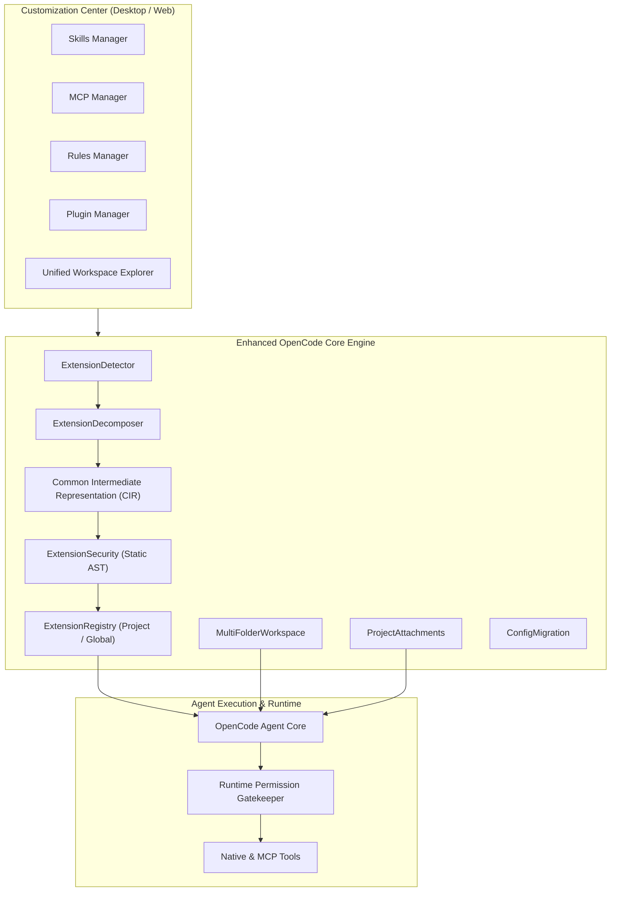

<p align="center">
  <picture>
    <source srcset="packages/console/app/src/asset/logo-ornate-dark.svg" media="(prefers-color-scheme: dark)">
    <source srcset="packages/console/app/src/asset/logo-ornate-light.svg" media="(prefers-color-scheme: light)">
    
  </picture>
</p>

# Enhanced OpenCode — Universal Agent Ecosystem

> A production-grade enhanced fork of [OpenCode](https://github.com/anomalyco/opencode) featuring the **Universal Agent Extension Compatibility Engine (UECE)**, a unified **Customization Center**, and **Dynamic Multi-Folder Workspaces**.

---

## 1. Project Overview

Enhanced OpenCode extends the official OpenCode platform into a universal hub for AI coding-agent customizations. Modern AI development ecosystems have fragmented across distinct platforms—Google Antigravity, Anthropic Claude Code, Cursor, OpenAI Codex, and OpenCode. Each defines proprietary formats for skills, tool connections (MCP), instruction rules, and plugins.

**Enhanced OpenCode bridges these ecosystems into a unified developer experience:**
- Run **Google Antigravity** skills and bundles directly inside OpenCode.
- Import **Claude Code** `CLAUDE.md` and Claude Desktop MCP configurations.
- Parse and apply **Cursor** `.cursorrules` and `.cursor/rules/*.mdc` with frontmatter glob targeting.
- Manage multi-repository codebases using **Dynamic Multi-Folder Workspaces**.
- Inspect, test, and sandbox all extensions through a centralized **Customization Center**.
- Preserve existing OpenCode configurations with **Fork Data Isolation**.

---

## 2. Key Features

### 2.1 Universal Agent Extension Compatibility Engine (UECE)
- **Common Intermediate Representation (CIR)**: Normalizes foreign skills, MCP configs, rules, and plugins into a strongly-typed internal representation (`@opencode/schema/extension`).
- **Automatic Package Decomposition**: Disassembles composite packages (e.g. Antigravity bundles containing skills, MCP configs, and rules) into distinct components while retaining provenance and dependency links.
- **AI-Assisted Gap Analysis & Adapters**: Evaluates compatibility gaps and synthesizes non-destructive adapters for non-native extensions without fabricating unsupported features.
- **Extension Registry & Rollback**: Versioned storage (`project` or `global` scope) with atomic rollback to previous versions and immutable audit logging.

### 2.2 Unified Customization Center
- Six dedicated management panels in the Desktop and Web UI:
  1. **Skills**: Browse, inspect, import (Git/local/archive), enable/disable, and review supporting files.
  2. **MCP Servers**: Configure Stdio/SSE/HTTP servers, import Claude Desktop/Cursor JSON, run live latency diagnostics, and discover tools.
  3. **Rules & Instructions**: Import and preview `CLAUDE.md`, `.cursorrules`, and `.mdc` rules with interactive glob pattern testing.
  4. **Plugins**: Inspect capabilities, review AST security findings, and manage lifecycle.
  5. **Imported Packages**: Manage multi-component bundles and view decomposition trees.
  6. **Compatibility Adapters**: Review gap analyses, adapter proposals, and compatibility ratings.

### 2.3 Advanced Project & Multi-Folder Workspaces
- **Dynamic Multi-Folder Roots**: Attach multiple independent directories across unrelated paths or drives to a single project.
- **Primary Root Switching**: Switch the primary folder or relink moved paths without copying files.
- **Unified Workspace Explorer**: Unified file tree aggregating all attached roots with live `active` vs `missing` status detection.
- **Project Attachments Engine**: Attach, full-text index, and preview project specifications, diagrams, and documentation in `.opencode/attachments/`.
- **Persistent Multi-Conversations**: Create multiple independent chat branches within the same project, sharing attached roots and specifications.

### 2.4 Security & Sandboxing
- **Static AST & Regex Security Scanner**: Pre-installation scanning for destructive filesystem commands (`SEC-CMD-FORMAT`), exposed API tokens (`SEC-SECRET-TOKEN`), dynamic code execution (`eval`), and network exfiltration.
- **Strict Path Traversal Guards**: Defends against directory climbing (`..`), null-byte injections, and zip-slip vulnerabilities during archive extraction.
- **Permission Gatekeeping**: Prompt instructions are never treated as security boundaries. Real execution adheres strictly to OpenCode's host-level approval mechanisms (`Permission.ask`).

### 2.5 Data Preservation & Independent Identity
- **Isolated Storage**: Stores user data in `~/.config/opencode-enhanced` and `~/.local/share/opencode-enhanced` (or via `OPENCODE_ENHANCED_CONFIG_DIR`), preventing collision with upstream OpenCode.
- **One-Click Config Migration**: Safely imports MCP servers, model keys, and skills from an existing OpenCode installation non-destructively.

---

## 3. Architecture



---

## 4. Installation & Quick Start

### 4.1 Packaged Desktop Application (Windows, macOS, Linux)

Prebuilt standalone binaries are generated in `dist/desktop/`:

| Platform | Binary Location | Execution |
| :--- | :--- | :--- |
| **Windows (x64)** | `dist/desktop/app/OpenCode Dev.exe` | Run directly or launch installer |
| **macOS (Apple Silicon / Intel)** | `dist/desktop/opencode-desktop-mac-*.app.tar` | Extract and drag to `/Applications` |
| **Linux (x64 / arm64)** | `dist/desktop/*.AppImage`, `.deb`, `.rpm` | `chmod +x *.AppImage && ./*.AppImage` |

### 4.2 Standalone CLI Binary
The bundled command-line executable operates with zero external runtime dependencies:
```bash
# Windows
.\dist\desktop\app\resources\opencode-cli.exe --version

# Run standalone agent
.\dist\desktop\app\resources\opencode-cli.exe --standalone
```

### 4.3 Running from Source
Requires [Bun](https://bun.sh) (v1.4.4+):
```bash
# Clone the repository and checkout the enhanced branch
git clone https://github.com/anomalyco/opencode.git
cd opencode
git checkout universal-agent-ecosystem

# Install dependencies
bun install

# Run the CLI in development mode
bun dev

# Run the Desktop application in development mode
bun dev:desktop
```

---

## 5. Build & Packaging Instructions

### 5.1 Full Production Build
To compile the desktop bundles, renderer, and runtime assets:
```bash
# Build desktop renderer, preload, and main bundles
cd packages/desktop
bun run build

# Package standalone desktop application into dist/desktop/app
bun run pack
```

### 5.2 Standalone CLI Compilation
```bash
cd packages/cli
bun run script/build.ts --single --skip-install --skip-web-ui
```

### 5.3 Monorepo Typecheck & Test Verification
```bash
# Typecheck all 35 packages across the monorepo
bun turbo typecheck

# Run core integration and acceptance test suites
cd packages/core
bun test test/extension test/workspace-manager test/integration

# Run desktop baseline regression test suite
cd packages/desktop
bun test
```

---

## 6. Configuration & Fork Data Isolation

Enhanced OpenCode ensures complete independence from upstream OpenCode:

| Configuration Item | Upstream OpenCode | Enhanced OpenCode (Fork) |
| :--- | :--- | :--- |
| **Config Directory** | `~/.config/opencode` | `~/.config/opencode-enhanced` |
| **Data Directory** | `~/.local/share/opencode` | `~/.local/share/opencode-enhanced` |
| **State Directory** | `~/.local/state/opencode` | `~/.local/state/opencode-enhanced` |
| **Environment Override** | `OPENCODE_CONFIG_DIR` | `OPENCODE_ENHANCED_CONFIG_DIR` |

### Non-Destructive Config Migration
To import configurations, MCP servers, and skills from an existing OpenCode installation:
```ts
import { ConfigMigration } from "@opencode/core/workspace-manager/config-migration"

// Discover and import without modifying original files
const result = yield* ConfigMigration.importUpstream({
  importMcp: true,
  importModels: true,
  importSkills: true,
})
```

---

## 7. Extension Compatibility Guide

### 7.1 Google Antigravity Skills & Packages
- Place Antigravity packages with `SKILL.md` and supporting subdirectories (`scripts/`, `resources/`, `references/`) in your project or global skill path.
- The compatibility engine automatically parses frontmatter metadata, preserves resource paths, and generates agent invocation tools.

### 7.2 Anthropic Claude Code Rules & MCP
- Place `CLAUDE.md` in the project root or import `claude_desktop_config.json`.
- The engine imports stdio/SSE server definitions and exposes Claude rules directly to the model prompt.

### 7.3 Cursor Rules (`.cursorrules` & `.mdc`)
- Cursor `.mdc` files in `.cursor/rules/` are parsed with frontmatter attributes (`description`, `globs`, `alwaysApply`).
- Glob patterns are evaluated against active files to deliver relevant instructions without exceeding context limits.

---

## 8. Verification & Test Metrics

- **Desktop Baseline Regression Suite**: **235 passed, 0 failed** (887 expect calls across 40 files).
- **Core Integration & Subsystems**: **54 passed, 0 failed** (364 expect calls across 13 files).
- **Monorepo Typecheck**: **35 / 35 packages clean** (0 errors).
- **Unified Multi-Folder Indexing**: **162 ms** across 6 roots (50 active files).
- **Project Attachment Extraction**: **42 ms** for a 500-line markdown specification.
- **Attachment Search Query**: **7.89 ms** full-text response.

---

## 9. Deliverable Reports

Detailed technical documentation and audit reports:
- [`docs/UPSTREAM_AUDIT.md`](docs/UPSTREAM_AUDIT.md) — Upstream architecture & baseline inspection.
- [`docs/SECURITY_AUDIT.md`](docs/SECURITY_AUDIT.md) — STRIDE threat modeling & static AST rules.
- [`docs/REGRESSION_REPORT.md`](docs/REGRESSION_REPORT.md) — Upstream regression analysis.
- [`docs/INTEGRATION_TEST_REPORT.md`](docs/INTEGRATION_TEST_REPORT.md) — Subsystem integration test logs.
- [`docs/PERFORMANCE_REPORT.md`](docs/PERFORMANCE_REPORT.md) — Monotonic benchmarks & failure recovery.
- [`FINAL_DELIVERY_REPORT.md`](FINAL_DELIVERY_REPORT.md) — Comprehensive executive delivery report.

---

## 10. License

Enhanced OpenCode is licensed under the [MIT License](LICENSE).
