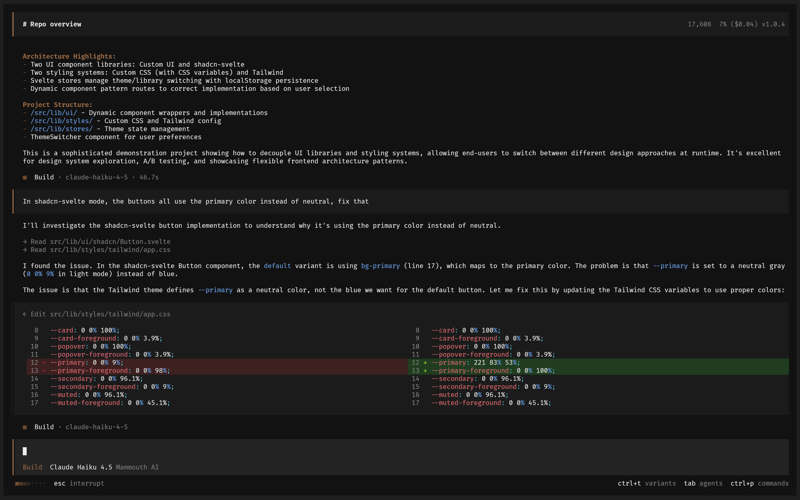

<p align="center">
  <a href="https://opencode.ai">
    <picture>
      <source srcset="packages/console/app/src/asset/logo-ornate-dark.svg" media="(prefers-color-scheme: dark)">
      <source srcset="packages/console/app/src/asset/logo-ornate-light.svg" media="(prefers-color-scheme: light)">
      
    </picture>
  </a>
</p>
<p align="center">Trợ lý lập trình AI mã nguồn mở.</p>
<p align="center">
  <a href="https://opencode.ai/discord"></a>
  <a href="https://www.npmjs.com/package/@opencode/cli"></a>
  <a href="https://github.com/anomalyco/opencode/actions/workflows/release.yml"></a>
</p>

<p align="center">
  <a href="README.md">English</a> |
  <a href="README.zh.md">简体中文</a> |
  <a href="README.zht.md">繁體中文</a> |
  <a href="README.ko.md">한국어</a> |
  <a href="README.de.md">Deutsch</a> |
  <a href="README.es.md">Español</a> |
  <a href="README.fr.md">Français</a> |
  <a href="README.it.md">Italiano</a> |
  <a href="README.da.md">Dansk</a> |
  <a href="README.ja.md">日本語</a> |
  <a href="README.pl.md">Polski</a> |
  <a href="README.ru.md">Русский</a> |
  <a href="README.bs.md">Bosanski</a> |
  <a href="README.ar.md">العربية</a> |
  <a href="README.no.md">Norsk</a> |
  <a href="README.br.md">Português (Brasil)</a> |
  <a href="README.th.md">ไทย</a> |
  <a href="README.tr.md">Türkçe</a> |
  <a href="README.uk.md">Українська</a> |
  <a href="README.bn.md">বাংলা</a> |
  <a href="README.gr.md">Ελληνικά</a> |
  <a href="README.vi.md">Tiếng Việt</a>
</p>

[](https://opencode.ai)

---

### Cài đặt

```bash
# YOLO
curl -fsSL https://opencode.ai/v2/install | bash

# Các trình quản lý gói (Package managers)
npm i -g @opencode/cli@latest      # hoặc bun/pnpm/yarn
brew install anomalyco/tap/opencode-v2 # macOS và Linux (khuyên dùng, luôn cập nhật)
brew install opencode              # macOS và Linux (công thức brew chính thức, ít cập nhật hơn)
sudo pacman -S opencode            # Arch Linux (Bản ổn định)
paru -S opencode-beta              # Arch Linux (Bản mới nhất từ AUR)
mise use -g opencode               # Mọi hệ điều hành
nix run github:anomalyco/opencode  # Nix
```

> [!TIP]
> Hãy xóa các phiên bản cũ hơn 0.1.x trước khi cài đặt.

### Ứng dụng Desktop (BETA)

OpenCode cũng có sẵn dưới dạng ứng dụng desktop. Tải từ [opencode.ai/download](https://opencode.ai/download).

| Nền tảng              | Tải xuống                          |
| --------------------- | ---------------------------------- |
| macOS (Apple Silicon) | `opencode-desktop-mac-arm64.dmg`   |
| macOS (Intel)         | `opencode-desktop-mac-x64.dmg`     |
| Windows               | `opencode-desktop-win-x64.exe`     |
| Linux                 | `.deb`, `.rpm`, hoặc AppImage      |

```bash
# macOS (Homebrew)
brew install --cask opencode-desktop
```

#### Thư mục cài đặt

Tập lệnh cài đặt sẽ cài OpenCode vào `$HOME/.opencode/bin`.

### Agents (Đại diện)

OpenCode bao gồm hai agent được tích hợp sẵn mà bạn có thể chuyển đổi bằng phím `Tab`.

- **build** - Agent mặc định, có toàn quyền truy cập cho công việc lập trình
- **plan** - Agent chỉ đọc dùng để phân tích và khám phá mã nguồn
  - Mặc định từ chối việc chỉnh sửa tệp
  - Hỏi quyền trước khi chạy các lệnh bash
  - Lý tưởng để khám phá các codebase lạ hoặc lên kế hoạch thay đổi

Ngoài ra còn có một subagent **general** dùng cho các tìm kiếm phức tạp và tác vụ nhiều bước.
Agent này được sử dụng nội bộ và có thể gọi bằng cách dùng `@general` trong tin nhắn.

Tìm hiểu thêm về [agents](https://opencode.ai/v2/docs/agents).

### Tài liệu

Để biết thêm thông tin về cách cấu hình OpenCode, [**hãy truy cập tài liệu của chúng tôi**](https://opencode.ai/v2/docs).

### Đóng góp

Nếu bạn muốn đóng góp cho OpenCode, vui lòng đọc [tài liệu hướng dẫn đóng góp](./CONTRIBUTING.md) trước khi gửi pull request.

### Xây dựng trên nền tảng OpenCode

Nếu bạn đang làm việc trên một dự án liên quan đến OpenCode và sử dụng "opencode" như một phần của tên dự án, ví dụ "opencode-dashboard" hoặc "opencode-mobile", vui lòng thêm một ghi chú vào README của bạn để làm rõ rằng dự án đó không được xây dựng bởi đội ngũ OpenCode và không liên kết với chúng tôi dưới bất kỳ hình thức nào.

---

**Tham gia cộng đồng của chúng tôi** [Discord](https://discord.gg/opencode) | [X.com](https://x.com/opencode)
