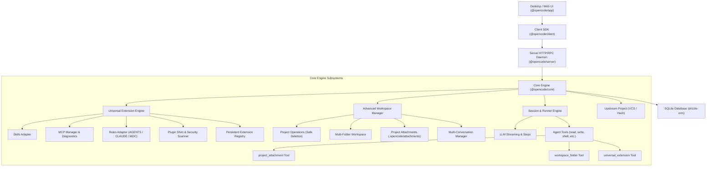

# Enhanced OpenCode System Architecture

## 1. System Overview

Enhanced OpenCode transforms OpenCode into a **Universal Agent Ecosystem** and **Advanced Workspace Environment**. It preserves OpenCode's core agent engine, event sourcing, and streaming execution while introducing two major subsystems:

1. **Universal Agent Extension Compatibility Engine**: A cross-platform extension ingestion, inspection, adaptation, and sandboxed execution system supporting **OpenCode**, **OpenAI Codex**, **Claude Code**, **Google Antigravity**, and **Cursor**.
2. **Advanced Project and Workspace Management Subsystem**: A robust multi-folder workspace abstraction supporting dynamic root additions across drives, persistent project attachments, safe non-destructive deletions, and multi-conversation management.



---

## 2. Common Intermediate Representation (CIR)

To bridge extensions from disparate platforms without rewriting third-party code, the system defines a **Common Intermediate Representation (CIR)** in [`packages/schema/src/extension.ts`](file:///c:/Users/gaumi/Documents/hidden_gravity/open_code/packages/schema/src/extension.ts).

### 2.1 Core Schema Entities

```ts
export type Platform = "opencode" | "claude" | "codex" | "antigravity" | "cursor" | "custom"
export type Category = "skill" | "mcp" | "rule" | "plugin"
export type Scope = "global" | "project"
export type Status = "enabled" | "disabled" | "quarantined" | "incompatible"

export interface CIR {
  readonly id: string
  readonly name: string
  readonly version: string
  readonly description: string
  readonly sourcePlatform: Platform
  readonly category: Category
  readonly scope: Scope
  readonly status: Status
  readonly executionMode: "native" | "adapted" | "shim" | "sandboxed"
  readonly entrypoint?: string
  readonly instructions?: string
  readonly tools: ReadonlyArray<McpToolDescriptor>
  readonly dependencies: ReadonlyArray<string>
  readonly permissions: Permissions
  readonly provenance: {
    readonly origin: "local" | "git" | "registry"
    readonly url?: string
    readonly commit?: string
    readonly path?: string
  }
}
```

---

## 3. Subsystem A: Universal Agent Extension Compatibility Engine

### 3.1 Platform & Extension Detector ([`packages/core/src/extension/detector.ts`](file:///c:/Users/gaumi/Documents/hidden_gravity/open_code/packages/core/src/extension/detector.ts))
Inspects directory contents, file markers, and manifests to classify platforms:
- **OpenCode**: Detects `opencode.json`, `.opencode/`, `SKILL.md`.
- **Claude Code**: Detects `CLAUDE.md`, `.claude/`, `claude_desktop_config.json`.
- **OpenAI Codex**: Detects `codex.json`, `codex/skills/`, `.codex/`.
- **Google Antigravity**: Detects `antigravity.json`, `skills/*/SKILL.md` with multi-directory supporting scripts (`scripts/`, `resources/`).
- **Cursor**: Detects `.cursorrules`, `.cursor/rules/*.mdc`.

### 3.2 Skills Compatibility Adapter ([`packages/core/src/extension/skills/adapter.ts`](file:///c:/Users/gaumi/Documents/hidden_gravity/open_code/packages/core/src/extension/skills/adapter.ts))
- **Remote Git Ingestion**: Clones public or private Git repositories with optional `--branch`, `--tag`, `--commit`, and subdirectory filters.
- **Structure Preservation**: Preserves the complete directory hierarchy (supporting scripts, assets, references, dependencies).
- **Metadata Translation**: Parses YAML frontmatter (`name`, `description`, `tools`, `parameters`) and produces executable invocation wrappers.
- **Scope & Lifecycle**: Manages installation into `global` or `project` scopes with enable/disable toggling and atomic rollback.

### 3.3 MCP Manager & Connection Diagnostics ([`packages/core/src/extension/mcp/manager.ts`](file:///c:/Users/gaumi/Documents/hidden_gravity/open_code/packages/core/src/extension/mcp/manager.ts))
- **Transports**: Stdio, HTTP SSE, and OAuth transports.
- **Preflight Diagnostics (`testServer`)**:
  - Tests binary existence on `PATH` or exact filesystem location.
  - Validates execution permissions and environment variables.
  - Measures connection handshake latency and roundtrip time.
  - Performs live tool discovery with schema validation.
  - Automatically redacts sensitive tokens and credentials from diagnostic logs.
- **Cross-Platform Config Import**:
  - Ingests `claude_desktop_config.json` into OpenCode MCP servers.
  - Ingests Cursor `cursor_mcp.json` into OpenCode MCP servers.

### 3.4 Universal Rules Adapter ([`packages/core/src/extension/rules/adapter.ts`](file:///c:/Users/gaumi/Documents/hidden_gravity/open_code/packages/core/src/extension/rules/adapter.ts))
- **Unified Rule Parser**: Parses `AGENTS.md`, `CLAUDE.md`, `.cursorrules`, and Cursor `.cursor/rules/*.mdc`.
- **Precedence & Globs**: Respects glob file patterns (e.g., `src/**/*.tsx`), `alwaysApply` flags, and priority weights.
- **Dynamic Context Formatting**: Evaluates applicable rules against active working files and injects structured instruction blocks into prompt context.

### 3.5 Plugin Compatibility & Security Scanner ([`packages/core/src/extension/security.ts`](file:///c:/Users/gaumi/Documents/hidden_gravity/open_code/packages/core/src/extension/security.ts), [`packages/core/src/extension/plugin/adapter.ts`](file:///c:/Users/gaumi/Documents/hidden_gravity/open_code/packages/core/src/extension/plugin/adapter.ts))
- **Static AST & Pattern Analysis**:
  - Checks for command injection (`eval`, `child_process`, `exec`, `spawn`).
  - Checks for sensitive data leaks (`PRIVATE KEY`, AWS credentials, API tokens).
  - Checks for path traversal vulnerabilities (`../`, absolute root escapes).
- **Compatibility Wrapper Generator**: For foreign plugins requiring unsupported APIs, generates safe shims or reports exact unsupported capabilities.

### 3.6 Persistent Extension Registry ([`packages/core/src/extension/registry.ts`](file:///c:/Users/gaumi/Documents/hidden_gravity/open_code/packages/core/src/extension/registry.ts))
- Records installed extensions in `.opencode/extensions.json` (project scope) or `$GLOBAL_CONFIG/extensions.json` (global scope).
- Supports atomic register, toggle, and remove operations.

---

## 4. Subsystem B: Advanced Project & Workspace Management

### 4.1 Project Operations & Safe Deletion ([`packages/core/src/workspace-manager/project.ts`](file:///c:/Users/gaumi/Documents/hidden_gravity/open_code/packages/core/src/workspace-manager/project.ts))
- **Operations**: `create`, `rename`, `archive`, `restore`, `delete`, `search`.
- **Non-Destructive Deletion Policy**: Deleting or archiving a project removes only metadata and index state. The actual source files on disk are **never deleted** unless `deletePhysicalFiles: true` is explicitly requested with user confirmation.

### 4.2 Dynamic Multi-Folder Workspaces ([`packages/core/src/workspace-manager/multi-folder.ts`](file:///c:/Users/gaumi/Documents/hidden_gravity/open_code/packages/core/src/workspace-manager/multi-folder.ts))
- **Multiple Roots**: Attaches arbitrary independent directories, separate Git repositories, and cross-drive folders (e.g. `C:\` and `D:\`) to a single project.
- **Unified Workspace Tree**: Merges all attached folders into a single hierarchical explorer view with folder labels.
- **Root Management**: Allows switching the primary folder root and relinking missing or moved directories.
- **Safe Detachment**: Detaching a secondary folder removes it from the workspace configuration without altering physical files on disk.

### 4.3 Persistent Project Attachments ([`packages/core/src/workspace-manager/attachments.ts`](file:///c:/Users/gaumi/Documents/hidden_gravity/open_code/packages/core/src/workspace-manager/attachments.ts))
- **Storage**: Persists files under `.opencode/attachments/` within the project root.
- **MIME Categorization**: Automatically categorizes files into `source`, `document`, `data`, `image`, and `archive`.
- **Text Extraction & Indexing**: Extracts plain text from source code, Markdown, text files, and JSON/CSV data.
- **Search Engine**: Full-text and keyword search across all attached project documents.

### 4.4 Persistent Multi-Conversations ([`packages/core/src/workspace-manager/conversations.ts`](file:///c:/Users/gaumi/Documents/hidden_gravity/open_code/packages/core/src/workspace-manager/conversations.ts))
- Allows users to maintain multiple independent conversation threads per project with custom naming, archiving, and deletion.

---

## 5. Subsystem C: Native Agent Context Tools

Three native tools are registered into `packages/core/src/plugin/internal.ts` giving the agent direct runtime awareness of the extended workspace:

1. **`workspace_folder`** ([`packages/core/src/tool/plugin/workspace-folder.ts`](file:///c:/Users/gaumi/Documents/hidden_gravity/open_code/packages/core/src/tool/plugin/workspace-folder.ts)):
   - Actions: `list` (returns all attached roots with primary status and availability), `tree` (returns the unified multi-folder file tree).
2. **`project_attachment`** ([`packages/core/src/tool/plugin/attachment.ts`](file:///c:/Users/gaumi/Documents/hidden_gravity/open_code/packages/core/src/tool/plugin/attachment.ts)):
   - Actions: `list` (lists project attachments by category), `read` (reads content or metadata of an attachment), `search` (searches indexed attachment text).
3. **`universal_extension`** ([`packages/core/src/tool/plugin/universal-extension.ts`](file:///c:/Users/gaumi/Documents/hidden_gravity/open_code/packages/core/src/tool/plugin/universal-extension.ts)):
   - Actions: `list` (lists all installed cross-platform extensions and active rules), `get` (retrieves full CIR descriptor and available tools).

---

## 6. Subsystem D: User Interface & Settings

Implemented in `packages/app/src/settings/`:
- **`project-extensions.tsx`**: Universal Extension Center featuring tabs for MCP Servers, Plugins, Skills, Rules, and LSPs, plus live MCP diagnostics runner and Universal Skill Import modal.
- **`project-folders.tsx`**: Multi-folder workspace explorer with folder cards, primary root badges, attach folder dialog, safe detach, and path relinking.
- **`project-attachments.tsx`**: Project attachments hub with category filters (Source, Documents, Data, Images, Archives), search bar, file upload dialog, and text preview drawer.
- **`shell.tsx` & `route.ts`**: Settings routing and navigation tabs integrated cleanly with search index.
