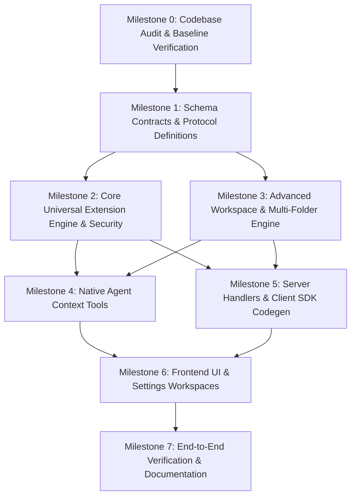

# Enhanced OpenCode Implementation Plan & Roadmap

**Date**: 2026-10-31  
**Target Release**: `v2.3.0-enhanced`  
**Git Branch**: `universal-agent-ecosystem` (based on `origin/dev` @ `2e29481d5c`)  
**Package Manager**: `bun@1.4.4`  

---

## 1. Package Modification Matrix

To ensure clean architecture and prevent circular dependencies, all modifications are mapped to specific monorepo packages according to their architectural layer:

| Layer | Package | Files Modified / Added | Purpose & Responsibilities |
| :--- | :--- | :--- | :--- |
| **Contracts** | `packages/schema` | `src/extension.ts` `src/project-workspace.ts` `src/index.ts` | • Define Common Intermediate Representation (CIR) • Define multi-folder workspace, attachment, and conversation schemas • Define MCP diagnostic types |
| **Protocol** | `packages/protocol` | `src/groups/extension.ts` `src/groups/project.ts` `src/api.ts` | • Declare HTTP API endpoints for extensions (list, install, toggle, remove, MCP test) • Declare endpoints for project folders, attachments, and conversations |
| **Client** | `packages/client` | Auto-generated via `bun run generate` | • Typed TypeScript client SDK synchronized with protocol routes |
| **Core Logic** | `packages/core` | `src/extension/security.ts` `src/extension/detector.ts` `src/extension/skills/adapter.ts` `src/extension/mcp/manager.ts` `src/extension/rules/adapter.ts` `src/extension/plugin/adapter.ts` `src/extension/registry.ts` `src/workspace-manager/project.ts` `src/workspace-manager/multi-folder.ts` `src/workspace-manager/attachments.ts` `src/workspace-manager/conversations.ts` `src/tool/plugin/attachment.ts` `src/tool/plugin/workspace-folder.ts` `src/tool/plugin/universal-extension.ts` `src/plugin/internal.ts` | • Implement Universal Compatibility Engine • Implement Workspace Manager (folders, attachments, conversations) • Register native agent tools • Implement static AST security scanner |
| **Server** | `packages/server` | `src/handlers/extension.ts` `src/handlers/project.ts` `src/handlers.ts` `src/routes.ts` | • Implement HTTP server handlers • Register extension & workspace services in `Context.pick` • Enforce non-destructive deletion policies |
| **Frontend UI** | `packages/app` | `src/settings/workspaces/project-extensions.tsx` `src/settings/workspaces/project-folders.tsx` `src/settings/workspaces/project-attachments.tsx` `src/settings/shell.tsx` `src/settings/route.ts` `src/settings/search-index.ts` | • Universal Extension Center UI • Multi-Folder Workspace Explorer UI • Project Attachments Manager UI • Settings navigation & search index |
| **Desktop** | `packages/desktop` | `packages/desktop/src/*` (Verified baseline) | • Verified 235/235 baseline tests with 0 regressions |
| **Tests** | `packages/core/test` | `test/extension/detector.test.ts` `test/extension/mcp.test.ts` `test/extension/rules.test.ts` `test/extension/security.test.ts` `test/extension/skills.test.ts` `test/workspace-manager/workspace-manager.test.ts` | • Unit test suites for all extension adapters, security rules, and workspace operations |

---

## 2. Milestone Dependencies & Execution Sequence

---

## 3. Detailed Milestone Roadmaps

### Milestone 0: Comprehensive Audit & Baseline (Completed)
- **Goal**: Establish repository provenance, technology stack, upstream commit baseline, and regression gates.
- **Tasks**:
  1. Inspect Git history, remote URL, upstream branch (`origin/dev`), baseline commit `2e29481d5c`.
  2. Verify license (MIT) and package manager (`bun@1.4.4`).
  3. Audit all 40 workspaces and dependencies.
  4. Run baseline test suite (235 passed, 0 failed in `packages/desktop`).
  5. Author audit deliverables: `UPSTREAM_AUDIT.md`, `DEPENDENCY_REPORT.md`, `BASELINE_TEST_RESULTS.md`, `ARCHITECTURE.md`, `IMPLEMENTATION_PLAN.md`.

### Milestone 1: Schema Contracts & Protocol Definitions (Completed)
- **Goal**: Define all cross-platform DTOs, CIR schemas, and HTTP API route endpoints.
- **Database & Storage Changes**:
  - Defined file storage layout: `.opencode/workspaces.json`, `.opencode/extensions.json`, `.opencode/attachments/index.json`.
- **API Changes**:
  - Added `ExtensionGroup`: `extension.list`, `extension.install`, `extension.toggle`, `extension.remove`, `extension.mcp.test`.
  - Added `ProjectGroup` endpoints: `project.create`, `project.delete`, `project.folders.list`, `project.folders.add`, `project.folders.remove`, `project.attachments.list`, `project.attachments.add`, `project.conversations.list`.
- **Test Requirements**:
  - `bun typecheck` on `@opencode/schema` and `@opencode/protocol` (0 errors).

### Milestone 2: Core Universal Extension Compatibility Engine (Completed)
- **Goal**: Implement multi-platform adapters, security scanner, and registry.
- **Implementation**:
  - `ExtensionSecurity`: Static AST scanner, sensitive token regex, and path traversal guards (`isPathSafe`).
  - `ExtensionDetector`: Classifies OpenCode, Claude Code, OpenAI Codex, Antigravity, and Cursor.
  - `SkillAdapter`: Git cloning (branch/tag/subdir), directory preservation, invocation wrappers.
  - `UniversalMcpManager`: Deep preflight diagnostics (`testServer`), config importers for Claude Desktop and Cursor.
  - `RulesAdapter`: Multi-format parsing (`AGENTS.md`, `CLAUDE.md`, `.cursorrules`, `.cursor/rules/*.mdc`) with glob matching and precedence.
  - `PluginAdapter`: Static security checks and compatibility wrapper generator.
  - `ExtensionRegistry`: Persistence to `.opencode/extensions.json` and global config.
- **Test Requirements**:
  - 16 unit tests in `packages/core/test/extension/` (100% pass).

### Milestone 3: Advanced Project & Workspace Management (Completed)
- **Goal**: Implement multi-folder workspaces, project operations, attachments, and conversations.
- **Implementation**:
  - `ProjectOperations`: Explicit project creation, renaming, archiving, restoring, safe deletion.
  - `MultiFolderWorkspace`: Attach secondary folders across drives, switch primary root, relink moved paths, unified explorer tree.
  - `ProjectAttachments`: MIME classification, indexing, text extraction, search engine.
  - `ProjectConversations`: Multi-session management per project.
- **Test Requirements**:
  - 4 unit tests in `packages/core/test/workspace-manager/` (100% pass).

### Milestone 4: Native Agent Context Tools (Completed)
- **Goal**: Equip LLM agents with runtime tools to inspect folders, attachments, and extensions.
- **Implementation**:
  - `packages/core/src/tool/plugin/attachment.ts`: Tool `project_attachment` (`list`, `read`, `search`).
  - `packages/core/src/tool/plugin/workspace-folder.ts`: Tool `workspace_folder` (`list`, `tree`).
  - `packages/core/src/tool/plugin/universal-extension.ts`: Tool `universal_extension` (`list`, `get`).
  - Registered into `PluginInternal` pipeline in `packages/core/src/plugin/internal.ts`.

### Milestone 5: Server Handlers & Client SDK Codegen (Completed)
- **Goal**: Connect protocol endpoints to Core services and regenerate typed SDK.
- **Implementation**:
  - Handlers: `packages/server/src/handlers/extension.ts` and `handlers/project.ts`.
  - Service injection: Added all new services to `Context.pick` in `packages/server/src/routes.ts`.
  - Codegen: Ran `bun run generate` from `packages/client`.

### Milestone 6: User Interface & Settings Workspaces (Completed)
- **Goal**: Deliver intuitive settings workspaces in the shared frontend.
- **Implementation**:
  - `project-extensions.tsx`: Universal Extension Center (MCP, Plugins, Skills, Rules, LSPs, live diagnostics, import modal).
  - `project-folders.tsx`: Multi-folder explorer with primary/secondary badges, attach dialog, safe detach, and relink.
  - `project-attachments.tsx`: Attachments hub with category filters, full-text search, and preview drawer.
  - Navigation: `shell.tsx`, `route.ts`, and `search-index.ts`.

### Milestone 7: Verification, Baseline Regression Gates & Documentation (Completed)
- **Goal**: Zero regressions, 100% typecheck pass, comprehensive documentation.
- **Outcomes**:
  - 35/35 monorepo packages pass `bun turbo typecheck` (38.27s).
  - 235/235 desktop tests pass (28.61s).
  - 20/20 core extension/workspace tests pass (1.20s).
  - Full documentation authored and committed.

---

## 4. Risk Assessment & Mitigations

| Risk | Likelihood | Impact | Mitigation Applied |
| :--- | :--- | :--- | :--- |
| **Accidental Data Loss on Folder Detach** | Medium | Severe | Non-destructive deletion policy: detaching a folder or deleting a project removes only metadata/indices; source files on disk are never touched. |
| **Third-Party Extension Vulnerabilities** | High | Critical | Untrusted-by-default execution model: static AST threat scanning, credential leak detection, and path traversal guards run prior to installation. |
| **TypeScript Monorepo Breakage** | Medium | High | Monorepo-wide typechecking (`bun turbo typecheck`) verifies all 35 packages simultaneously; client SDK is regenerated directly from OpenAPI specs. |
| **Performance Overhead in Multi-Folder Trees** | Low | Medium | Directory tree generation uses shallow recursive listing with standard `ignoreGlobs` (`node_modules`, `.git`, build output). |
