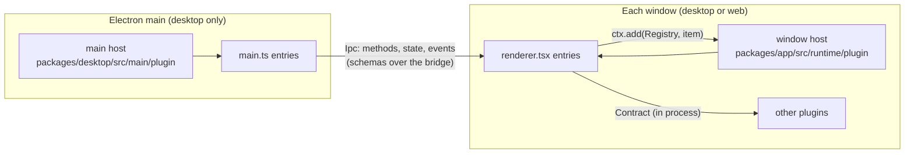
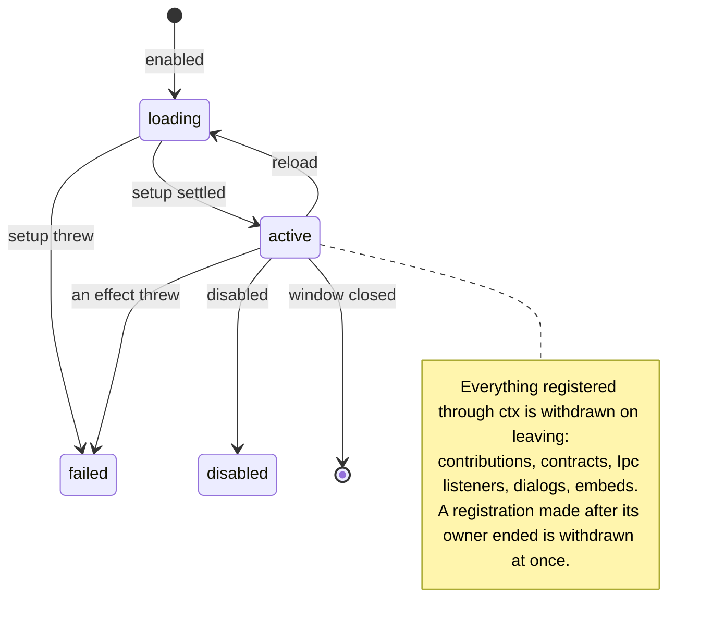
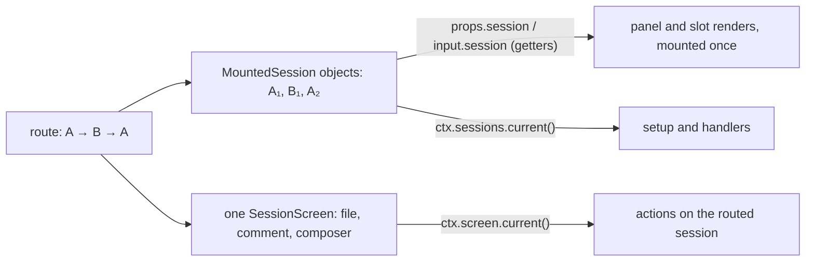
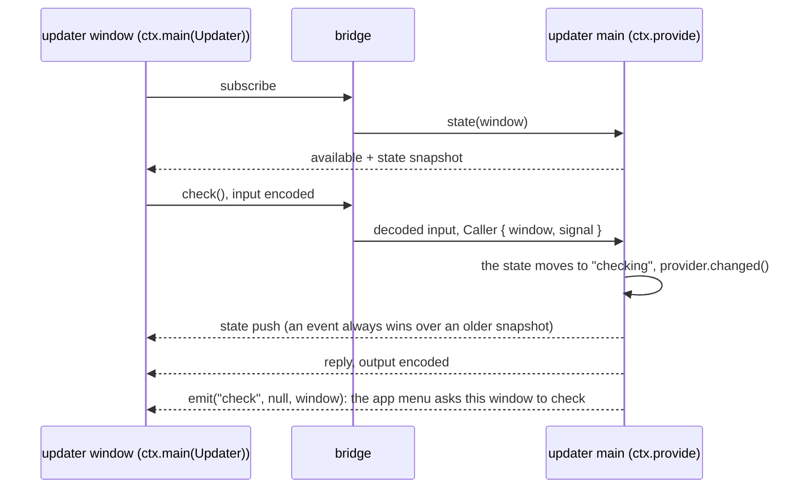

# Built-in GUI plugins

Every feature of the desktop and web app that is not the core shell is a built-in GUI plugin: the terminal, review, files, the browser, SSH, WSL, the updater and more. Each one builds only on the GUI plugin SDK in [`packages/plugin/src/gui`](../plugin/src/gui), the same `@opencode/plugin/gui` that third-party plugins use. The SDK is typed so that the common bugs fail to compile or fail the lint, and every declaration has TSDoc, so editor hovers answer most questions. This guide shows how the parts fit, with code from the plugins that ship. [Build your first plugin](#build-your-first-plugin) walks through [`src/pairing`](src/pairing), a small built-in that uses both processes. `bun run lint` checks every code block marked with its source against that source.

- Window SDK: `@opencode/plugin/gui` ([`index.ts`](../plugin/src/gui/index.ts))
- Main-process SDK: `@opencode/plugin/gui/main` ([`main.ts`](../plugin/src/gui/main.ts))
- Host-only, never published: `@opencode/plugin/gui/host` ([`host.ts`](../plugin/src/gui/host.ts)): `compose`, the bridge protocol and the plugin bundle evaluator
- Built-ins only, never published: `@opencode/plugin/gui/builtin` ([`builtin.ts`](../plugin/src/gui/builtin.ts)): `onIdle`, store migrations, lazily loaded locales (`builtinCatalog`), and the registry fields and host abilities no third-party plugin needs (see [Built-in only](#built-in-only))
- Rules for agents: [`AGENTS.md`](AGENTS.md)



## Anatomy

```text
src/pairing/
├── index.ts          Plugin.define: os, stores, i18n
├── contract.ts       tokens other code may import: Ipc, Contract, Registry
├── renderer.tsx      window entry, default export Plugin.Setup<typeof definition>
├── main.ts           main entry, default export Plugin.MainSetup (desktop only)
├── page.tsx          heavy UI, loaded with lazy()
└── i18n/en.ts        English copy
```

Unit tests of logic that carries a contract sit beside the code as `*.test.ts`, as in `src/ssh/` and `src/updater/`.

`Plugin.define` is the manifest, the same call a third-party plugin's `./gui-experimental` makes. The host lists attach each built-in's lazy `windowEntry` and `mainEntry`. The host reads the manifest before any entry loads. No definition declares an id: the host gives a built-in its key in `compose`, and a bundle the server plugin's id, as `ctx.id`. That id prefixes every id the plugin creates: commands, panel keys, stored keys, contract and Ipc ids.

| Field    | What it declares                                                              | In the context        |
| -------- | ----------------------------------------------------------------------------- | --------------------- |
| `os`     | The operating systems it runs on; omit it to run everywhere, the web included |                       |
| `stores` | Window state the host loads before it is read                                 | `ctx.stores.name`     |
| `i18n`   | The plugin's copy                                                             | `ctx.t`, `ctx.plural` |

Contracts are not declared: a plugin provides its own with `ctx.provide` and reads others' with `ctx.use` at runtime.

- [`src/renderer.ts`](src/renderer.ts) and [`src/main.ts`](src/main.ts) list the built-ins, each through `compose` from `@opencode/plugin/gui/host`. These are the only files that name built-ins. "Built-in" is the host's flag for what these lists load, as the TUI marks its built-ins; the definitions themselves are ordinary `Plugin.define` calls.
- Another plugin imports only your `contract.ts`.
- A window entry loads with the app. Keep it small and put heavy UI behind `lazy()`.

## The context

Setup receives one context. Components read the same object with `usePlugin<typeof definition>()`.

| Member                    | Window                                                                                      | Main                                 |
| ------------------------- | ------------------------------------------------------------------------------------------- | ------------------------------------ |
| Host APIs                 | `ctx.layout`, `ctx.sessions`, `ctx.storage`, `ctx.desktop`, … (see the [catalog](#catalog)) | `ctx.storage`, `ctx.windows`, …      |
| Another plugin's contract | `ctx.use(token)`: `Accessor<Live<T>>`                                                       |                                      |
| Your own main entry       | `ctx.main(Ipc)`: its `IpcClient`                                                            |                                      |
| Declared stores           | `ctx.stores.name`: `Persisted`, or `(session) => Persisted`                                 | `ctx.storage.store(key, options)`    |
| Contribute to a registry  | `ctx.add(Registry, item)`                                                                   | `ctx.add(MenubarItem, item)`         |
| Provide a contract        | `ctx.provide(Contract, impl)`                                                               | `ctx.provide(Ipc, impl)`             |
| Lifetime                  | Solid's `onCleanup` and `ctx.signal`                                                        | `ctx.onCleanup(fn)` and `ctx.signal` |
| Copy                      | `ctx.t(key, params)`, `ctx.plural(key, count)`                                              | the same                             |

- Host APIs are getters: an API you never read costs nothing.
- No host API throws before the app interface mounts: reads return their documented defaults (`ctx.layout.ready()` is false), and writes such as `ctx.layout.open` wait, then apply in call order. A dialog `ctx.dialogs.open` opens meanwhile shows after the interface's first render.
- Registries and contracts are tokens: `ctx.add(Command, …)`, `ctx.provide(FileTree, …)`.
- A plugin provides only tokens under its own id (`<id>` or `<id>.<name>`): the window provides contracts, main provides Ipcs. The host throws for any other.
- Bind each contract component with `bindPlugin` during the provider's setup so `usePlugin` reads the provider's context, not the consumer's. Props retain their getters. Leave data methods such as `Changes.diffs()` unwrapped. Annotate the bound component's props: TypeScript cannot infer them inside `ctx.provide`.

```tsx
ctx.provide(FileTree, { Tree: bindPlugin((props: FileTreeProps) => <Tree {...props} />) })
```

- Labels follow the language only when the host reads them again. Contribute an item with labels in the function form, `ctx.add(Command, () => ({ ... title: ctx.t("open") ... }))`: the window runs the function again when what it reads changes, and main reads it on every list. A plain `title: ctx.t("open")` in a fixed item keeps the language it was read in.
- An item with a field of a literal type (`hidden: true`, a `section`, an `icon`, a menu name) needs a return annotation in the function form, `(): Command => ({ ... })`, or no overload matches.
- Objects the host keeps stable read their labels from getters, `get title() { return ctx.t("title") }`: the tabs `Panel.list` returns, and items with a `render`, such as panels and settings pages.

```ts
const setup: Plugin.Setup<typeof definition> = (ctx) => {
  const changes = ctx.use(Changes) // Accessor<Live<Changes>>
  const prefs = ctx.stores.prefs.value // loaded before setup
  ctx.add(Command, () => ({ id: "open", title: ctx.t("open"), run: () => ctx.layout.settings(ctx.id) }))
}
```

### Lifetimes



- A registration ends with the current Solid owner: a component, a `createKeyed` run, or else the plugin.
- Teardown of other work: return a cleanup from setup, as server and TUI plugins do, or use `onCleanup` in the window and `ctx.onCleanup` in main.
- Window setup is synchronous: its `Cleanup | void` return type rejects async functions, and the host fails thenable-returning JavaScript setups instead of waiting for them. Put async work in `createKeyed` or `createLatest`, with `ctx.signal` or a signal derived from it. Only main setup may be async. After each `await` there is no owner; return if the signal aborted before registering or changing state. Late registrations remain safe: the host releases them when the owner or instance ended.

The project menu (`src/details/location-menu.tsx`) keeps a session's uncommitted changes loaded only while review is
active and the menu shows. When review restarts or goes away, the outer run ends and its watch goes with it:

```tsx
createKeyed(ctx.use(Changes), (changes) =>
  createKeyed(
    () => props.shown && props.screen,
    (screen) => onCleanup(changes.watch(screen, "details")),
  ),
)
```

### The routed session



- Each routed session gets its own frozen `MountedSession`: `key`, `id`, `tab`, `server`, `directory` and `visit` never change on one object, and `location`, `project` and the other fields read that session's data, never the route's. It has nothing that acts on another session.
- A session that moves to another directory gets a new object too, with the new `directory` and the same `key` and `visit`. Key per-session state by `key`.
- Renders stay mounted. The host hands them the next object through a reactive getter, so read `props.session` (panels), `input.session` (slots) or `state.session` (tab labels) where you use it, and never copy it into a variable.
- The workspace files, line comments and composer follow the route, so they belong to the session screen. An action through it targets the session routed at that moment. Read it inside a render or a handler, not once in setup. Key per-screen state, such as cached tab objects, by the screen; key per-session state by `session.key`.
- `ctx.screen.current()` and `ctx.sessions.current()` are published together in one batched effect after the screen's first render, with v2's original session-mount timing. Renders already receive their owning screen and session directly. Both public accessors are undefined during the first render, on Home, on a draft, before the interface mounts and once the route leaves the mounted screen. The screen has no `session` property.
- All panel callbacks take one named input: `list({ session, screen, open })`, `render({ tab, session, screen })`, `focus({ tab, session, screen, restored })`, `enter({ tab, session, screen })`, `close({ tab, session, screen })`, `reopen({ tab, session, screen })`, `normalize({ id, session, screen })`. Session fields are getters; the screen is the constant owning screen. Render tab fields are live getters too; lifecycle callbacks receive their event's tab. Stored ids and `restored` describe that call. Do not destructure live getters. Every `session.*` slot gets a non-null `screen`; `window.bottom` does not.
- Render effects can run before public publication too: change-list views call `Changes.watch(input.screen, source)`, not `ctx.screen.current()`, so their first demand is never lost.
- `fallback: true` opts a tab into selection when the stored selection is missing or cannot be selected; false or omission opts out. The host takes the first eligible regular tab, then a built-in's `first` tab, then a pinned tab, preserving order within each tier. Closing a tab still selects its neighbour.
- A `session.panel` menu item's `primary: true` makes the strip's + run it directly; the first primary item in `order` wins. It does not run automatically when an empty side region opens: the host shows its New tab view with the non-primary items that are not already open. `opened: true` hides an ordinary item from that launcher list, but not from the + menu.

```ts
ctx.add(Panel, {
  id: "main",
  region: "side",
  list: (input) => (input.open.includes("main") ? [tab] : []),
  // Runs once; `props.session` returns B's object after a switch to B, without a remount.
  render: (props) => <View session={props.session} screen={props.screen} tab={props.tab} />,
})

// The composer follows the route, so it belongs to the screen: the file reaches the session routed when this runs.
ctx.add(Command, () => ({
  id: "attach-readme",
  title: ctx.t("command.attachReadme"),
  enabled: !!ctx.screen.current(),
  run: () => ctx.screen.current()?.composer.attach({ type: "file", path: "README.md" }),
}))
```

## Primitives

| Primitive                                        | Use it for                                                                     |
| ------------------------------------------------ | ------------------------------------------------------------------------------ |
| `Plugin.define(definition)`                      | The manifest, typed so `Plugin.Setup<typeof definition>` sees the declarations |
| `compose({ id: definition })` (host only)        | A process's list of built-ins, keyed by id                                     |
| `Registry.define<T>(id)`                         | A list your plugin owns and others contribute to                               |
| `Contract.define<T, Id>(id)`                     | An in-process API one plugin provides to others                                |
| `Ipc.define(spec)`                               | The main ↔ window contract                                                    |
| `Store.global` / `Store.session`                 | Declared window state the host loads before you read it                        |
| `createKeyed(source, fn, { otherwise, equals })` | Side effects per provider generation or per value; the only sanctioned effect  |
| `createLatest(source, fetch)`                    | Async data that never suspends and drops stale replies                         |
| `createVisitState(initial)`                      | State that resets each time the user routes back to the session                |
| `usePlugin` / `usePanel` / `useDrawer`           | The context, the panel frame, and the narrow-screen drawer in components       |
| `bindPlugin(component)`                          | One contract component under its provider's context; data methods stay plain   |
| `onIdle(fn)` (built-ins only)                    | Preloading a lazy chunk while the app is idle                                  |

[Lifetimes](#lifetimes) shows `createKeyed` in files.

```ts
// Forget a selection when the user goes Home and back.
const [selected, setSelected] = createVisitState<string | undefined>(undefined)

// Compile the settings page while the app idles, not when settings opens. Import `onIdle` from `@opencode/plugin/gui/builtin`.
const Page = lazy(() => import("./page"))
onCleanup(onIdle(() => void Page.preload()))
```

Pairing's shipping page uses a query, not `createLatest`. It passes the query's abort signal directly to the no-input Ipc method; options are the only argument. The generation in the key asks again when main comes back:

<!-- source: src/pairing/page.tsx#screenActive -->

```tsx
const screenActive = useQuery(() => ({
  queryKey: [ctx.id, "screen-active", main()?.generation],
  queryFn: (input) => {
    const live = main()

    if (!live) throw new Error("Pairing's main side is not active")

    return live.value.screenActive({ signal: input.signal })
  },
  enabled: !!main(),
  gcTime: 0,
}))
```

## Catalog

Each line links to the file whose TSDoc covers every field.

SDK icon fields take an `IconName` from `@opencode/plugin/gui`: the names of the app's icon catalog (`@opencode/ui/icons/catalog`), which `bun run generate` in `packages/plugin` copies into `packages/plugin/src/gui/icon-name.ts`. `src/icon-name.typecheck.ts` fails the typecheck when the two drift. A plugin bundle cannot require `@opencode/ui`, so it renders an icon with `ctx.ui.Icon`, and the app's buttons, menus, dialog frame, fields, Markdown and code with the other `ctx.ui` components.

### Registries

| Registry                                          | Process | What an item is                                                                                                                                                     |
| ------------------------------------------------- | ------- | ------------------------------------------------------------------------------------------------------------------------------------------------------------------- |
| [`Command`](../plugin/src/gui/registries.ts)      | window  | A palette command with an optional keybind and slash command                                                                                                        |
| [`MenuItem`](../plugin/src/gui/registries.ts)     | window  | An item of a host menu: the side panel + menu, Add server, a server row                                                                                             |
| [`Panel`](../plugin/src/gui/registries.ts)        | window  | Tabs in the session's side region                                                                                                                                   |
| [`SettingsPage`](../plugin/src/gui/registries.ts) | window  | A settings page, a section on a host page, or rows in a host section                                                                                                |
| [`Server`](../plugin/src/gui/registries.ts)       | window  | A source of servers, such as SSH hosts                                                                                                                              |
| [`LinkHandler`](../plugin/src/gui/registries.ts)  | window  | Opens local links, such as file paths in messages, and says whether their target exists                                                                             |
| [`TitlebarItem`](../plugin/src/gui/registries.ts) | window  | A pill in the titlebar or the tabs footer                                                                                                                           |
| [`ComposerPill`](../plugin/src/gui/registries.ts) | window  | A pill in the row above a session's composer, optionally opening a menu of rows                                                                                     |
| [`Slot`](../plugin/src/gui/registries.ts)         | window  | Content for `window.bottom`, `session.header`, `session.location.menu`, `session.panel.end`; built-ins also fill `session.location.workspace`, `session.location.branch.menu` and `session.location.path.menu` through `BuiltinSlot` |
| [`Style`](../plugin/src/gui/registries.ts)        | window  | CSS imported with `?inline`                                                                                                                                         |
| [`MenubarItem`](../plugin/src/gui/main.ts)        | main    | An item of the native app menu                                                                                                                                      |

`session.location.menu` contributes items after the project menu's location details. It receives the owning `screen`,
the live `session`, and `shown`; keep data subscriptions active only while `shown` is true. Loading headers without an
owning screen show the host's location details without this slot.

`session.location.branch.menu` (built-ins only, through `BuiltinSlot`) contributes items after Copy branch name in
the branch submenu, with the same `screen`, live `session`, and project-menu `shown` context. It renders only when a
branch name and owning screen are available. Use it for actions on the branch's working directory, such as opening
an integrated terminal.

`session.location.path.menu` (built-ins only, through `BuiltinSlot`) contributes items after the host's copy and
reveal actions in the session directory's path submenu. It receives the same session context and renders only with
an owning screen. Use it for external-app actions on `session.directory` without duplicating the host's file-manager
action.

`session.location.workspace` (built-ins only, through `BuiltinSlot`) replaces the current location row with the same
session context plus its `label` and `icon`; one contribution owns it. Without a contribution, the host keeps its
static location row. Use it to attach location actions directly
to the displayed repository or worktree instead of adding a second menu item.

### Host APIs

| Property                     | Type ([window](../plugin/src/gui/host-apis.ts), [main](../plugin/src/gui/main.ts)) | What it does                                                     |
| ---------------------------- | ---------------------------------------------------------------------------------- | ---------------------------------------------------------------- |
| `ctx.layout`                 | `Layout`                                                                           | Side panel tabs, scroll offsets, settings, open project          |
| `ctx.sessions`               | `Sessions`                                                                         | Sessions of open tabs, and the mounted `MountedSession`          |
| `ctx.screen`                 | `Screen`                                                                           | Session screen files, comments, composer text, parts and model   |
| `ctx.storage`                | `Storage`                                                                          | Stores for keys known only at runtime, and window memory         |
| `ctx.system`                 | `System`                                                                           | Clipboard, saving files, `openExternal`                          |
| `ctx.desktop`                | `Desktop \| undefined`                                                             | Desktop-only: reveal, launch, installed, zoom, pick files        |
| `ctx.dialogs`                | `Dialogs`                                                                          | `open`, `confirm`, `alert`, `prompt`, `select`; close with owner |
| `ctx.toast`                  | `Toasts`                                                                           | Toasts that close when the plugin goes away                      |
| `ctx.tabs`                   | `Tabs`                                                                             | The shell's tab strip: list, open, show, move and close tabs     |
| `ctx.attention`              | `Attention`                                                                        | System notifications and sounds, per the user's settings         |
| `ctx.commands`               | `Commands`                                                                         | Runs a published or app command, as the palette does             |
| `ctx.links`                  | `Links`                                                                            | Opens a local link, or checks it exists, with the best handler   |
| `ctx.embeds`                 | `Embeds`                                                                           | Shows a web page the main entry created                          |
| `ctx.ui`                     | `Ui`                                                                               | The app's icons, buttons, menus, dialog frame, Markdown and code |
| `ctx.app`                    | `App`                                                                              | Version, channel, platform, packaged                             |
| `ctx.locale`                 | `Locale`                                                                           | Locale and writing direction                                     |
| `ctx.appearance`             | `Appearance`                                                                       | The user's mono font, and the light or dark scheme               |
| `ctx.router`                 | `Router`                                                                           | The route path, and whether it is changing                       |
| `ctx.keybinds`               | `Keybinds`                                                                         | Display and matching of command keybinds                         |
| `ctx.servers`                | `Servers`                                                                          | The servers the app lists, and each one's live `ServerRef`       |
| `ctx.workspaces`             | `Workspaces`                                                                       | `on("remove", …)` when a workspace is removed                    |
| `ctx.signal` (main)          | `AbortSignal`                                                                      | Aborts when the instance goes away                               |
| `ctx.onCleanup` (main)       | `(fn) => void`                                                                     | Runs `fn` when the instance goes away                            |
| `ctx.storage` (main)         | `Storage`                                                                          | Synchronous storage, the same `Persisted` shape                  |
| `ctx.log` (main)             | `Log`                                                                              | The desktop log file                                             |
| `ctx.app` (main)             | `App`                                                                              | The same shape; `platform` is `"desktop"`                        |
| `ctx.serverEndpoints` (main) | `ServerEndpoints`                                                                  | URL and credentials of a server the windows use                  |
| `ctx.windows` (main)         | `Windows`                                                                          | The app's main windows                                           |
| `ctx.embeds` (main)          | `Embeds`                                                                           | `create(view, window)` places a web page                         |
| `ctx.cli` (main)             | `Cli`                                                                              | The opencode CLI the app runs                                    |

### Built-in only

`@opencode/plugin/gui/builtin` holds what only the built-ins use. It is never published and is not in the modules a plugin bundle may require; a public SDK module never imports it.

| Export                                                  | What it adds                                                                                   |
| ------------------------------------------------------- | ---------------------------------------------------------------------------------------------- |
| `onIdle(fn)`                                            | Runs work while the main thread is idle, e.g. a lazy chunk's preload                           |
| `BuiltinPanel`, `BuiltinPanelTab`                       | `legacy` stored keys of a panel; `first` and stable `dom` ids of a tab                         |
| `BuiltinCommand`                                        | `follows`: share another command's shortcut inside `scope`                                     |
| `BuiltinStore`, `BuiltinStoreFrom`                      | Window stores imported from parts of the app's own keys                                        |
| `builtinContext(ctx)`                                   | `ctx.desktop.forceFocus`, `ctx.locale.setDirection`                                            |
| `builtinMainContext(ctx)`, `MainStoreFrom`, `Lifecycle` | Main stores imported from settings files or other namespaces, and `lifecycle.restart(handoff)` |
| `builtinCatalog(catalog)`, `BuiltinCatalog`             | Locales other than English as loaders, loaded when the user picks the locale                   |

Each registry token has the same id as the public one, so the host reads every item through it. The host builds every context with the built-in members; `builtinContext` and `builtinMainContext` only type them. A plugin bundle's catalog holds every locale inline, and the host rejects a bundle whose catalog has a loader.

```ts
i18n: builtinCatalog({ en, de: () => import("./i18n/de") }),
```

## Ipc: main ↔ window

An `Ipc` is the typed contract between a plugin's main entry and its windows. Its schemas encode every value that crosses the bridge.



- Define it in `contract.ts`. Its id is your plugin id, or `<id>.<name>`. A method without an input schema takes only optional call options: `pairing.screenActive({ signal })`, never an `undefined` placeholder.
- The main entry provides it with `ctx.provide`. The plugin's own windows call it with `ctx.main(Ipc)`: a call waits while main starts, and rejects once main cannot answer. Another plugin follows it with `ctx.use(Ipc)`, a `Live` accessor.
- On the web there is no main process: `ctx.use` reads the Ipc as `inactive`, and every `ctx.main` call rejects.
- Import a token's schemas only where they are needed: a chunk that loads with the first session can import the full token and call `ctx.main` there, so no schemas load at startup.

## Live and failure handling

`ctx.use(token)()` returns `Live<T>`, one object per provider transition. A provider that restarts is `pending` until it is back.

| Status                   | When                                                                     | What the user must see                    |
| ------------------------ | ------------------------------------------------------------------------ | ----------------------------------------- |
| `pending`                | The provider has not started, e.g. main is not up yet                    | A loading state, or nothing to click      |
| `active`                 | `value` is the contract or client; `generation` counts activations       | The feature                               |
| `inactive`, `"disabled"` | Turned off, not composed, or not on this platform (every Ipc on the web) | An unavailable state, never a dead button |
| `inactive`, `"failed"`   | Its setup threw                                                          | An unavailable state                      |

- Offer an action only while it can answer, or let it answer with an unavailable state. Never a silent `return`, never an endless spinner.
- `createKeyed` runs once per active generation. What the run registers ends with that generation. `otherwise` runs while there is none.
- An Ipc that goes away is a suspension, not a failure: keep what the user had and resume when it returns. No retry timer.
- An Ipc call can reject while the event that explains it is still in flight. When main reports an outcome as an event, let the event decide.
- A contribution that throws renders nothing and records the error. The rest of the window keeps working.

The updater's actions branch on the state its main entry pushes and still answer while main is missing:

<!-- source: src/updater/renderer.tsx#act -->

```tsx
const act = (name: "check" | "install") => {
  if (state()) return void import("./actions").then((module) => module[name](ctx, updater))

  // Not loaded yet, or not active (failed, or not on this platform): nothing can check or install.
  showToast({ title: ctx.t("common.requestFailed") })
}
```

The pairing settings page waits for its main side only where it needs it. Pairing codes come from the local server's `ServerRef`, so they never wait for main; remote access and the display setting render only while main is active, so the page never offers a switch that cannot answer:

<!-- source: src/pairing/page.tsx#main -->

```tsx
// Remote access and the display setting need pairing's main side; codes come from the server, so they never wait.
const main = () => {
  const live = props.pairing()

  return live.status === "active" ? live : undefined
}
```

## Stored state

Desktop windows load storage over IPC; the web reads it synchronously. A read before load passes every web test and still breaks desktop, so declare your stores.

| Kind                                    | Value                                                           | Loads                         |
| --------------------------------------- | --------------------------------------------------------------- | ----------------------------- |
| `Store.global(schema, initial, from?)`  | window `ctx.stores.name.value`: never undefined                 | Before setup                  |
| `Store.session(schema, initial, from?)` | window `ctx.stores.name(session).value`: undefined until loaded | When the session mounts       |
| `ctx.storage.store(key, options)`       | window `value`: undefined until loaded                          | When opened; for runtime keys |
| main `ctx.storage.store(key, options)`  | `value`: always defined                                         | Synchronously                 |

A public `from` names older keys of the same storage. Built-ins also import parts of the app's own keys, which they replaced: `BuiltinStore.global` and `BuiltinStore.session` from `@opencode/plugin/gui/builtin` take `{ key, sessions?, pick }`, and `builtinMainContext(ctx).storage` takes main's older homes.

Review imports one session's slice of an app key that holds every session:

<!-- source: src/review/index.ts#session -->

```ts
// The mode, selected file and open files of each session.
session: BuiltinStore.session(
  SessionState,
  { open: [] },
  {
    key: "layout",
    sessions: "sessionView",
    // An entry that holds only other fields, such as its scroll, holds no review state.
    pick: (entry: { reviewMode?: unknown; reviewFile?: unknown; reviewOpen?: unknown } | undefined) =>
      entry && [entry.reviewMode, entry.reviewFile, entry.reviewOpen].some((field) => field !== undefined)
        ? { mode: entry.reviewMode, file: entry.reviewFile, open: entry.reviewOpen }
        : undefined,
  },
),
```

SSH keeps a main store, imported from a key of the desktop settings file. `{ state: [namespace, key] }` names a key of another main storage namespace instead, and `file` another settings file:

<!-- source: src/ssh/main.ts#saved -->

```ts
// The saved hosts; stored before in the desktop settings file.
const saved = builtinMainContext(ctx).storage.store("servers", {
  schema: Schema.Array(SshConfig),
  initial: [],
  from: { settings: "ssh.servers" },
})
```

- Keys live in your namespace: `plugin.<id>.<name>` in the window, the store's name under `plugin.<id>` in main. The host first imports each built-in store once from its earlier `extension.` key by itself, so do not list that key in `from`. Other plugins never stored values there.
- `from` imports an older value once, while the store holds none. A list names older homes, newest first. With `pick`, the older key stays for its other owners; a pick returns undefined when that key holds none of its fields, never an object of undefined fields, so the next home is read.
- `update(mutate)` edits a deep-mutable draft and must return nothing or `undefined`. Returning the next value is a compile error and throws at runtime in both processes; use `set(next)` to replace the complete value, including main primitives and lists. Plain `Schema.Struct` fields work without `mutableKey`. Window calls wait for load and apply in call order with each other; main writes reach disk immediately. Runtime-key stores have the same contract.
- `Storage.remove(key, { from })` reads as `initial` again and never imports `from` again.
- Renaming a built-in that has shipped moves three things: stored keys (`from`), command ids (the keybind rename map in `packages/app/src/settings/keybinds/migration.ts`), and panel keys (`BuiltinPanel.legacy`). Never drop user data. The enable setting starts again under the new id.

A built-in always runs, whatever setting is saved under its id, so Extensions › Plugins does not list it, unless it failed: then its row shows the error and Reload, without a switch. For any other plugin, the setting saved under its id wins; with none, the plugin is enabled. A plugin from the config whose `os` leaves out this system never runs; Extensions › Plugins keeps its row, without a switch, with "Not available on this system." Both desktop hosts use this rule (`pluginEnabled`). A failed startup snapshot is unknown, so the window waits for the manager list rather than running disabled plugins.

## Runtime rules

- **Derive, don't sync.** A value computed from other state is a `createMemo` or a plain function. Never an effect that calls a setter.
- **Effects only for external sync.** `createKeyed` syncs with something outside Solid: the DOM, a widget, an embed, an Ipc subscription. Logic a user action causes goes in the handler.
- **Key an object source by its fields.** A `createKeyed` source that builds an object, such as `{ directory, tab }`, is a new key on every read. Pass `equals` to compare the fields that should run it again.
- **The lint bans raw effects.** `createEffect`, `createRenderEffect` and `createComputed` may not be imported in `packages/gui-plugins/src`; the SDK (`packages/plugin/src/gui`) wraps them. An escape hatch needs an `oxlint-disable` comment with a reason.
- **Suspense only on first load.** Wrap each `lazy()` component in its own `<Suspense>`, read async data through `.latest` or `createLatest`, and never read a refetching resource in render: it blanks the nearest boundary.
- **Stable objects.** Return the same object from `Panel.list` and reactive contributions while nothing changed, so the host never remounts.
- **No timeline work.** `session.header` is the only timeline surface.
- **No module state.** Keep state inside setup; module state survives a reload and leaks across windows.

## Testing

| Gate                    | Where                                                                                                                                           | Catches                                                                                                       |
| ----------------------- | ----------------------------------------------------------------------------------------------------------------------------------------------- | ------------------------------------------------------------------------------------------------------------- |
| SDK compile checks      | [`plugin/src/gui/context.typecheck.ts`](../plugin/src/gui/context.typecheck.ts), [`plugin.typecheck.ts`](../plugin/src/gui/plugin.typecheck.ts) | Async window setups, readonly drafts, panel and slot inputs, no-input Ipc options, declared store types       |
| Registry compile checks | [`plugin/src/gui/registries.typecheck.ts`](../plugin/src/gui/registries.typecheck.ts)                                                           | A `MenuItem` field its menu ignores                                                                           |
| Graph matrix            | `packages/app/component-tests/plugin-graph.spec.ts`                                                                                             | A built-in that fails when another built-in is disabled                                                       |
| Keeper suites           | `packages/app/e2e/regression/`                                                                                                                  | What the user sees, per product area                                                                          |
| Unit tests              | `*.test.ts` beside the code                                                                                                                     | Pure logic with a contract: paths, migrations, protocols                                                      |
| Lint gate               | `bun run lint` (oxlint, ast-grep, `script/sdk-docs.ts`); `bun run lint:changed`                                                                 | Raw effects, app imports, module state, undocumented SDK, a guide block that differs from its shipping source |

- Test a main entry through its `Ipc` contract with real inputs, not Electron mocks.
- The hosts own their contracts: main storage in `packages/desktop/src/main/plugin/storage.test.ts`, the real window host in `packages/app/component-tests/plugin-host.spec.ts`. A plugin does not test them again.
- Drive the race the user hits: a reload during async work, a store that loads late, an Ipc that goes away and returns.

## Build your first plugin

Pairing connects another device to this machine's server from anywhere, and keeps the display awake. It is small and uses both processes: a main entry that turns on remote access through the CLI and owns a power-save blocker, and a window entry that adds a settings page and a command. The window asks the local server for its remote address and pairing codes through `ctx.servers`: that server's `ServerRef` is already authenticated in the window, so its credentials never leave main. Each block below is its shipping source.

1. **Define the contract.** `contract.ts` holds the tokens other code may import, here the Ipc between pairing's main and window entries. It carries only what needs the main process: remote access, a setting of the background service, and the display sleep blocker. The schemas type both sides and encode every value.

<!-- source: src/pairing/contract.ts -->

```ts
import { Schema } from "effect"
import { Ipc } from "@opencode/plugin/gui"

/**
 * Turns on remote access and keeps this machine's display awake while another device uses it. The window asks the
 * local server for its remote address and pairing codes through its own `ServerRef`; remote access, which changes
 * the background service's settings through the CLI, and the display sleep blocker need the main process.
 */
export const Pairing = Ipc.define({
  id: "pairing",
  methods: {
    /** Whether remote access is on: the background service serves an OpenTunnel address. */
    remote: { output: Schema.Boolean },
    /**
     * Turns remote access on or off, then starts the background service again. Turning it on the first time creates
     * the tunnel, which can take a minute.
     */
    setRemote: { input: Schema.Boolean },
    /** Whether main holds the display sleep blocker. */
    screenActive: { output: Schema.Boolean },
    /** Holds or releases the display sleep blocker, and remembers the choice. */
    setScreenActive: { input: Schema.Boolean },
  },
})
```

2. **Write the definition.** Pairing declares only its copy: its Ipc is provided at runtime, and its state lives in main.

<!-- source: src/pairing/index.ts -->

```ts
import { Plugin } from "@opencode/plugin/gui"
import en from "./i18n/en"

export default Plugin.define({ i18n: { en } })
```

3. **Provide it from main.** Whether main keeps the display awake is a main store, read synchronously and imported once from the key the desktop kept it under before; a built-in names that older home through `builtinMainContext`. Remote access runs `opencode service` through `ctx.cli`, with the caller's signal for a read and `ctx.signal` for a change a closing window must not cancel. `ctx.onCleanup` releases the blocker when the instance goes away.

<!-- source: src/pairing/main.ts -->

```ts
import { execFile } from "node:child_process"
import { powerSaveBlocker } from "electron"
import { Schema } from "effect"
import { builtinMainContext } from "@opencode/plugin/gui/builtin"
import type { Plugin } from "@opencode/plugin/gui/main"
import { Pairing } from "./contract"

/** The display sleep blocker this instance holds, if any. */
type Blocker = { id?: number }

/** The last `opencode service` command; the next one starts after it settles. */
type Queue = { tail: Promise<unknown> }

const setup: Plugin.MainSetup = (ctx) => {
  // Whether main keeps the display awake; stored before in the desktop's own settings namespace.
  const stored = builtinMainContext(ctx).storage.store("keepScreenActive", {
    schema: Schema.Boolean,
    initial: false,
    from: { state: ["opencode.settings", "keepScreenActive"] },
  })

  const cli = ctx.cli
  const log = ctx.log
  const blocker: Blocker = {}
  const queue: Queue = { tail: Promise.resolve() }

  const release = () => {
    if (blocker.id === undefined) return
    powerSaveBlocker.stop(blocker.id)
    blocker.id = undefined
  }

  const keepScreenActive = (enabled: boolean) => {
    if (enabled && blocker.id === undefined) blocker.id = powerSaveBlocker.start("prevent-display-sleep")

    if (!enabled) release()
    stored.set(enabled)
  }

  // Remote access is a setting of the background service, so it changes through the CLI the app runs, as with
  // `opencode pair --remote`. A change restarts the service, so commands run one at a time.
  const service = (args: readonly string[], signal: AbortSignal) => {
    const run = queue.tail.then(
      () =>
        new Promise<string>((resolve, reject) => {
          execFile(
            cli.command[0] ?? "opencode",
            [...cli.command.slice(1), "service", ...args],
            { signal, windowsHide: true },
            (error, stdout, stderr) => {
              if (!error) return resolve(stdout.trim())
              log.write("error", "pairing service command failed", { args, error: error.message, stderr })
              reject(error)
            },
          )
        }),
    )

    queue.tail = run.catch(() => undefined)

    return run
  }

  if (stored.value) keepScreenActive(true)
  ctx.onCleanup(release)

  ctx.provide(Pairing, {
    remote: async (_, caller) => (await service(["get", "remote"], caller.signal)) === "true",
    // Changing the setting stops the service. Starting it here brings it back, with the tunnel when remote access is
    // on. A window that closes meanwhile does not cancel the change.
    setRemote: async (enabled) => {
      await service(["set", "remote", String(enabled)], ctx.signal)
      await service(["start"], ctx.signal)
    },
    screenActive: () => blocker.id !== undefined && powerSaveBlocker.isStarted(blocker.id),
    setScreenActive: (enabled) => keepScreenActive(enabled),
  })
}

export default setup
```

4. **Write the window entry.** Pairing exists only on desktop, so setup returns at once on the web. The settings page is heavy, so it loads behind `lazy()` and compiles while the app idles; its search entries are indexed without mounting it. The page receives the desktop's own server, found through `ctx.servers` by `builtin`, and `ctx.use(Pairing)`. The search entries for remote access and the display setting, like the settings themselves, exist only while main answers (see `main` under [Live and failure handling](#live-and-failure-handling)).

<!-- source: src/pairing/renderer.tsx -->

```tsx
import { lazy, onCleanup, Suspense } from "solid-js"
import { Command, SettingsPage, type Plugin } from "@opencode/plugin/gui"
import { onIdle } from "@opencode/plugin/gui/builtin"
import { Pairing } from "./contract"
import type definition from "./index"

const setup: Plugin.Setup<typeof definition> = (ctx) => {
  if (!ctx.desktop) return
  const layout = ctx.layout
  const servers = ctx.servers
  const pairing = ctx.use(Pairing)
  const Page = lazy(() => import("./page"))
  // Settings rows are small; load them while idle so settings opens without a blank row.
  onCleanup(onIdle(() => void Page.preload()))

  // The desktop's own server. Its ref is already authenticated in this window, so codes need no main process.
  const local = () =>
    servers
      .list()
      .map((id) => servers.get(id))
      .find((server) => server?.builtin)

  ctx.add(SettingsPage, {
    id: "pairing",
    icon: "server",
    get title() {
      return ctx.t("title")
    },
    get entries() {
      const pairingEntry = { id: "pairing", title: ctx.t("title"), keywords: "pair device qr phone remote" }

      // Remote access and the display setting exist only while pairing's main side answers.
      if (pairing().status !== "active") return [pairingEntry]

      return [
        pairingEntry,
        {
          id: "settings-remote-access",
          title: ctx.t("remote.title"),
          description: ctx.t("remote.description"),
          keywords: "internet tunnel opentunnel",
        },
        {
          id: "settings-keep-screen-active",
          title: ctx.t("screenActive.title"),
          description: ctx.t("screenActive.description"),
          keywords: "display sleep awake local",
        },
      ]
    },
    render: () => (
      <Suspense>
        <Page server={local} pairing={pairing} />
      </Suspense>
    ),
  })

  ctx.add(Command, () => ({
    id: "open",
    title: ctx.t("command.title"),
    group: ctx.t("command.category.server"),
    run: () => layout.settings("pairing"),
  }))
}

export default setup
```

5. **Register it.** A built-in joins both lists under its id, each composed with `compose`. The main list names every built-in, so their ids stay reserved, and adds pairing's main entry:

<!-- source: src/main.ts#builtins -->

```ts
/** Built-in plugins with their main entries, by id. Lists every built-in so their ids stay reserved. */
export const builtins = compose({
  context,
  btw,
  debug: { ...debug, mainEntry: () => import("./debug/main") },
  terminal,
  file,
  review,
  details,
  browser: { ...browser, mainEntry: () => import("./browser/main") },
  pairing: { ...pairing, mainEntry: () => import("./pairing/main") },
  updater: { ...updater, mainEntry: () => import("./updater/main") },
  ssh: { ...ssh, mainEntry: () => import("./ssh/main") },
  wsl: { ...wsl, mainEntry: () => import("./wsl/main") },
  "microsoft-office": microsoftOffice,
  sources,
})
```

The window list adds each window entry, loaded with the app:

<!-- source: src/renderer.ts#builtins -->

```ts
/** Built-in plugins with their window entries, by id. The only place host builds name built-ins. */
export const builtins = compose({
  context: { ...context, windowEntry: eager(contextRenderer) },
  btw: { ...btw, windowEntry: eager(btwRenderer) },
  debug: { ...debug, windowEntry: eager(debugRenderer) },
  terminal: { ...terminal, windowEntry: eager(terminalRenderer) },
  file: { ...file, windowEntry: eager(fileRenderer) },
  review: { ...review, windowEntry: eager(reviewRenderer) },
  details: { ...details, windowEntry: eager(detailsRenderer) },
  browser: { ...browser, windowEntry: eager(browserRenderer) },
  pairing: { ...pairing, windowEntry: eager(pairingRenderer) },
  updater: { ...updater, windowEntry: eager(updaterRenderer) },
  ssh: { ...ssh, windowEntry: eager(sshRenderer) },
  wsl: { ...wsl, windowEntry: eager(wslRenderer) },
  "microsoft-office": { ...microsoftOffice, windowEntry: eager(microsoftOfficeRenderer) },
  sources: { ...sources, windowEntry: eager(sourcesRenderer) },
})
```

Your own plugin takes the same steps:

1. **Pick the id.** It is your folder name and your key in both built-in lists, and it prefixes your commands, panel keys, stored keys and Ipc ids. A later rename needs the migrations under [Stored state](#stored-state).
2. **Define it.** Create `src/<id>/index.ts` with `Plugin.define({ i18n: { en } })`, and `src/<id>/i18n/en.ts` with your copy. Once other locales arrive, load them lazily with `builtinCatalog({ en, de: () => import("./i18n/de") })`.
3. **Declare the tokens.** Put any token another plugin or your main entry needs in `contract.ts`: a `Contract`, a `Registry` or an `Ipc`, each with an id under your plugin's id.
4. **Write the window entry.** In `renderer.tsx`, a `Plugin.Setup<typeof definition>` contributes with `ctx.add`, branches each action on `ctx.use(token)()`, runs side work in `createKeyed`, and keeps heavy UI behind `lazy()` with an `onIdle` preload.
5. **Write the main entry, if you need Node or Electron.** In `main.ts`, a `Plugin.MainSetup` provides your Ipc with `ctx.provide` and tears down with `ctx.onCleanup`.
6. **Declare your state.** Use `Store.global` or `Store.session` in the window and `ctx.storage.store` in main, with a `from` for every older home of the value.
7. **Register both entries** in `src/renderer.ts` and `src/main.ts`, as above. The graph matrix then boots the app with your plugin disabled.
8. **Test it.** Unit-test pure logic beside the code. Prove what the user sees with a case in the area's keeper suite in `packages/app/e2e/regression/`.
9. **Check it.** Run `bun run lint`, which includes `script/sdk-docs.ts`, then `bun run lint:changed`, and `bun typecheck` in `packages/gui-plugins` and `packages/plugin`.
